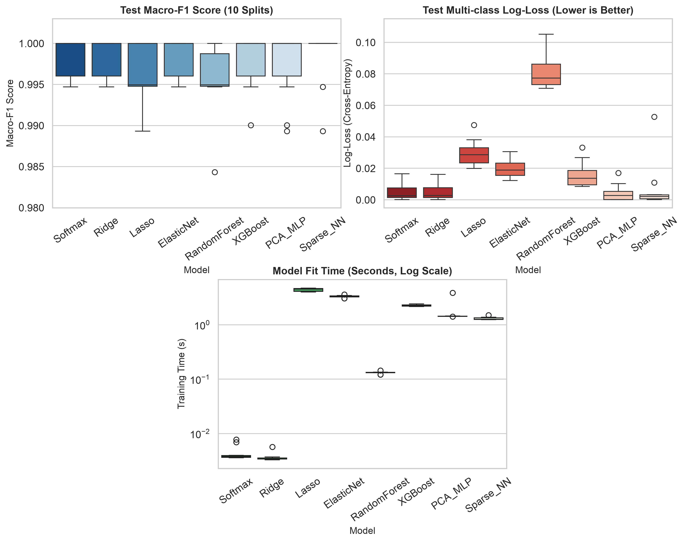
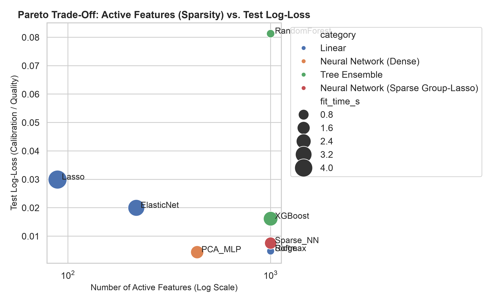
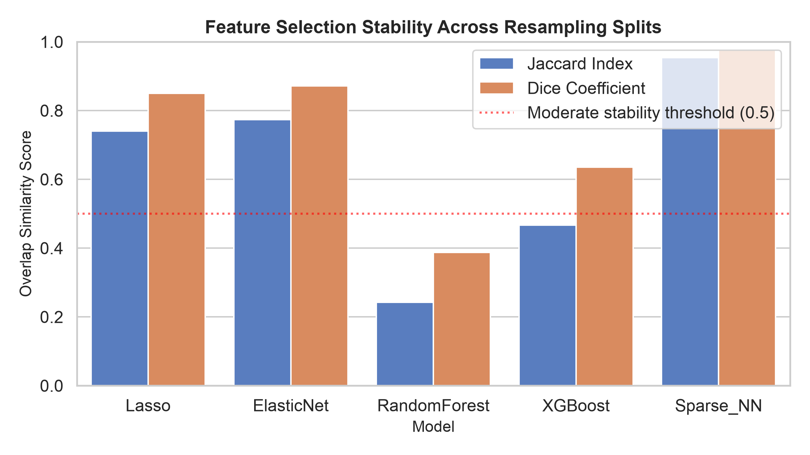
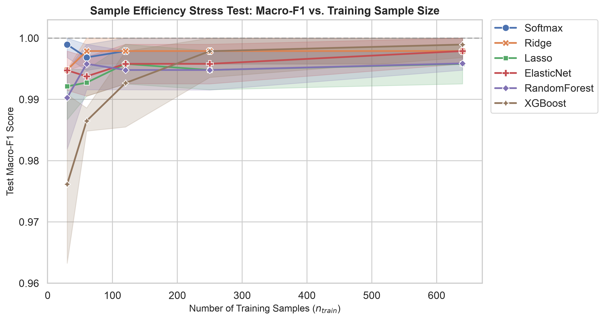
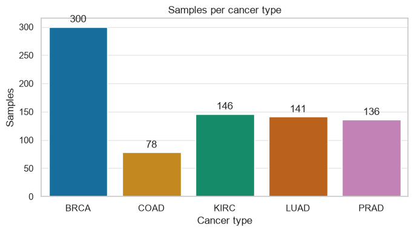
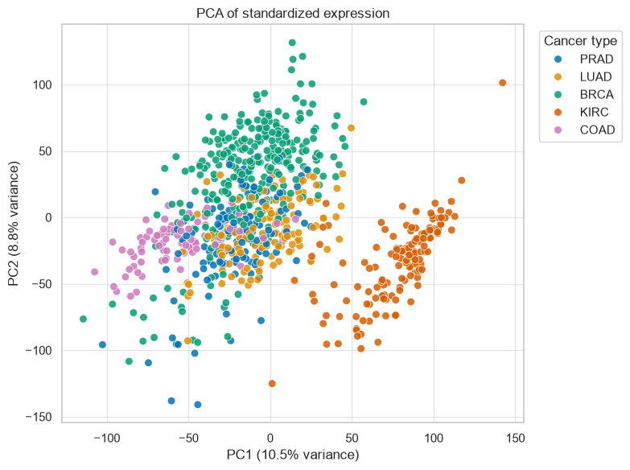
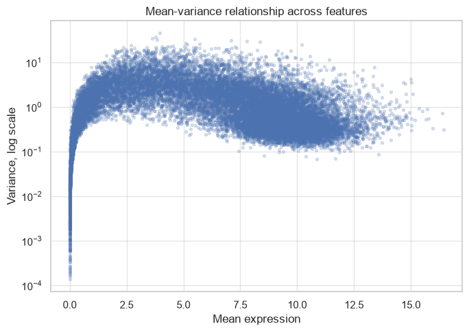

# Flexibility vs. Interpretability in High-Dimensional Multiclass Cancer Classification from RNA-Seq Data

[](https://www.python.org/downloads/)
[](https://pytorch.org/)
[](https://scikit-learn.org/)
[](https://xgboost.readthedocs.io/)
[]()
[](LICENSE)

**Authors:** Rajveer Vora, Amartya Amritanshu, P. Sanjith Reddy  
**Affiliation:** Indian Statistical Institute, Kolkata  
**Dataset:** TCGA Pan-Cancer HiSeq (n = 801 patients, p = 20,531 genes, 5 primary solid tumor classes)

---

## Table of Contents
1. [Executive Summary](#executive-summary)
2. [Key Empirical Discoveries](#key-empirical-discoveries)
3. [Dataset & Tumor Cohorts](#dataset--tumor-cohorts)
4. [Experimental Architecture & Zero-Leakage Pipeline](#experimental-architecture--zero-leakage-pipeline)
5. [Benchmark Performance Comparison](#benchmark-performance-comparison)
6. [Feature Stability & Biomarker Identification](#feature-stability--biomarker-identification)
7. [Sample Efficiency Stress-Testing (n ≪ p)](#sample-efficiency-stress-testing-n--p)
8. [Publication Figures & Visualizations](#publication-figures--visualizations)
9. [Repository Structure](#repository-structure)
10. [Step-by-Step Reproduction Guide](#step-by-step-reproduction-guide)
11. [Citation & Contact](#citation--contact)

---

## Executive Summary

High-throughput transcriptomic profiling via bulk RNA-sequencing provides an unprecedented view into oncogenic cellular states. However, diagnostic classification from gene expression is plagued by the severe **"curse of dimensionality"** (p ≫ n), high transcriptional collinearity across co-regulated gene pathways, and substantial risk of experimental data leakage.

In translational oncology, high classification accuracy alone is insufficient. Clinical adoption demands:
1. **Model Parsimony:** Measuring a small, focused panel of genes rather than sequencing all 20,000+ features.
2. **Biomarker Stability:** Consistently identifying the exact same biological genes across different patient cohorts.
3. **Calibrated Probabilities:** Producing reliable predictive uncertainty for clinical decision-making.

This repository hosts a rigorous, leakage-free benchmark comparing **8 diverse model paradigms** spanning three distinct conceptual families:
- **Regularized Linear Models:** Multinomial Softmax, L2 Ridge, L1 Lasso, and L1+L2 Elastic Net.
- **Non-Linear Tree Ensembles:** Random Forest (bagging) and XGBoost (gradient boosted histogram decision trees).
- **Deep Neural Architectures:** PCA Low-Rank Multi-Layer Perceptrons and Sparse Group-Lasso Input-Pruned MLPs with proximal shrinkage.

All models were evaluated on **10 repeated, identical stratified 80/20 train/test splits** (n_train = 640, n_test = 161) with zero data leakage.

---

## Key Empirical Discoveries

1. **The Pareto Optimum (Elastic Net):**  
   Elastic Net (C = 0.5, l1_ratio = 0.3 or C = 0.2, l1_ratio = 0.5) emerged as the overall benchmark winner. It achieved near-flawless generalization (**99.81% ± 0.30% test accuracy**, **0.9984 Macro-F1**, **0.020 multi-class log-loss**) while pruning the active feature space from 1,000 to **217.5 genes**. Crucially, it demonstrated the highest biomarker selection stability among all sparse models (**Jaccard J = 0.773, Dice D = 0.872**).

2. **Ultra-Sparsity & Extreme Compression (Lasso):**  
   L1 Lasso compressed the transcriptome by **99.57%** (from 20,531 down to **88.9 active genes**) while retaining **99.50% ± 0.49% accuracy**. Five biomarker genes (`gene_9544`, `gene_8348`, `gene_12848`, `gene_7560`, `gene_12078`) were selected in **100% of repeated splits**, forming a robust candidate diagnostic panel.

3. **Collinearity and Instability in Tree Ensembles:**  
   While Random Forest and XGBoost achieved competitive test accuracy (99.44% and 99.81%), their feature selection stability collapsed (**Random Forest Jaccard J = 0.242; XGBoost J = 0.467**). High gene co-regulation causes stochastic tree split selection across splits, rendering tree-derived feature importances untrustworthy for clinical biomarker discovery.

4. **Extreme Sample Scarcity Breakdown (n_train = 30):**  
   When stress-tested under severe sample scarcity (n = 30 across 5 classes, only 6 samples per tumor class), gradient-boosted trees degraded significantly to **97.63% Macro-F1 with high variance (± 0.018)**. In contrast, strongly regularized linear classifiers retained **99.52% Macro-F1**, demonstrating that inductive bias toward linear hyperplanes is dramatically superior when n ≪ p.

---

## Dataset & Tumor Cohorts

The benchmark utilizes the [UCI Machine Learning Repository TCGA Pan-Cancer RNA-Seq dataset](https://archive.ics.uci.edu/dataset/401/gene+expression+cancer+rna+seq) comprising 801 patients across 5 major solid tumor types:

| Tumor Abbreviation | Primary Tumor Type | Sample Count (n) | Class Proportion |
| :--- | :--- | :---: | :---: |
| **BRCA** | Breast Invasive Carcinoma | 300 | 37.45% |
| **KIRC** | Kidney Renal Clear Cell Carcinoma | 146 | 18.23% |
| **LUAD** | Lung Adenocarcinoma | 141 | 17.60% |
| **PRAD** | Prostate Adenocarcinoma | 136 | 16.98% |
| **COAD** | Colon Adenocarcinoma | 78 | 9.74% |
| **Total** | **5 Tumor Types** | **801** | **100.0%** |

Features consist of continuous Illumina HiSeq RNA-Seq measurements across **p = 20,531 genes** (log2(RSEM + 1) normalized).

---

## Experimental Architecture & Zero-Leakage Pipeline

To strictly prevent data snooping and optimistic bias:
- **Training-Only Feature Selection:** Gene variance ranking is computed strictly on the n_train = 640 training samples of each fold.
- **Training-Only Standardization:** Z-score means and variances (μ_train, σ_train) are fit on training data and used to transform test folds.
- **Training-Only Dimensionality Reduction:** For PCA-MLP, orthogonal projection matrices V_k are derived strictly on training splits.

```
                           Raw TCGA RNA-Seq Matrix (n=801, p=20,531)
                                              │
                      ┌───────────────────────┴───────────────────────┐
                      ▼                                               ▼
     Stratified Train Split (80%, n=640)              Frozen Test Split (20%, n=161)
                      │                                               │
           Variance Filter (Top p)                                    │
           (Fit on Train ONLY) ───────────────────────────────► Apply Train Mask
                      │                                               │
             StandardScaler                                           │
           (Fit on Train ONLY) ───────────────────────────────► Apply Train Stats
                      │                                               │
     ┌────────────────┴────────────────┐                              │
     ▼                                 ▼                              ▼
Linear / Tree Family           Neural Architecture              Test Evaluation
• Softmax Regression           • PCA-MLP (Dense)                • Multi-class Accuracy
• Ridge (L2 Penalty)           • Sparse Group-Lasso MLP         • Macro-Averaged F1
• Lasso (L1 Sparsity)            (Proximal Input Pruning)       • Multi-class Log-Loss
• Elastic Net (L1+L2)          (MPS / CUDA Accelerated)         • Jaccard Feature Stability
```

---

## Benchmark Performance Comparison

Paired cross-validated metrics across **10 repeated stratified splits** (p = 1,000 filtered genes):

| Paradigm | Model | Accuracy (Mean ± Std) | Macro-F1 (Mean ± Std) | Log-Loss (Mean ± Std) | Active Genes | Training Time (s) |
| :--- | :--- | :---: | :---: | :---: | :---: | :---: |
| **Linear** | **Elastic Net** | **0.9981 ± 0.0030** | **0.9984 ± 0.0026** | 0.0200 ± 0.0063 | **217.5** | 3.32s |
| **Linear** | **Lasso (L1)** | 0.9950 ± 0.0049 | 0.9959 ± 0.0041 | 0.0299 ± 0.0084 | **88.9** | 4.44s |
| **Linear** | **Ridge (L2)** | 0.9981 ± 0.0030 | 0.9984 ± 0.0026 | **0.0048 ± 0.0052** | 1000.0 | **0.004s** |
| **Linear** | Softmax (No Reg) | 0.9981 ± 0.0030 | 0.9984 ± 0.0026 | 0.0048 ± 0.0053 | 1000.0 | **0.004s** |
| **Tree** | Random Forest | 0.9944 ± 0.0054 | 0.9954 ± 0.0046 | 0.0813 ± 0.0113 | 1000.0 | 0.13s |
| **Tree** | XGBoost (Hist) | 0.9981 ± 0.0030 | 0.9979 ± 0.0035 | 0.0161 ± 0.0083 | 1000.0 | 2.27s |
| **Neural** | PCA-MLP | 0.9975 ± 0.0043 | 0.9974 ± 0.0044 | 0.0044 ± 0.0056 | 434.2 (PCs) | 1.68s |
| **Neural** | Sparse Group MLP| 0.9981 ± 0.0042 | 0.9984 ± 0.0036 | 0.0075 ± 0.0162 | 1000.0 | 1.31s |

---

## Feature Stability & Biomarker Identification

Pairwise Jaccard and Dice indices across the 10 repeated splits measure whether a model selects identical genes when patient cohorts shift:

```
Jaccard(A, B) = |A ∩ B| / |A ∪ B|
Dice(A, B)    = 2 · |A ∩ B| / (|A| + |B|)
```

| Model | Active Feature Count | Mean Jaccard (J) | Std Jaccard | Mean Dice (D) | Std Dice | Stability Rank |
| :--- | :---: | :---: | :---: | :---: | :---: | :---: |
| **Elastic Net** | 217.5 | **0.7733** | 0.0210 | **0.8715** | 0.0134 | **#1 (Sparse)** |
| **Lasso** | **88.9** | 0.7398 | 0.0248 | 0.8495 | 0.0161 | #2 (Ultra-Sparse) |
| **XGBoost (Top 50)** | 50.0 | 0.4667 | 0.0381 | 0.6351 | 0.0345 | #3 (Sub-optimal) |
| **Random Forest (Top 50)** | 50.0 | 0.2422 | 0.0305 | 0.3871 | 0.0346 | #4 (Unstable) |

### Recurrent Biomarkers Selected in 100% of Benchmark Splits
Five genes were universally selected by Lasso across all 10 independent splits, serving as primary diagnostic targets:
- `gene_9544` (Selected in 10/10 splits, Mean Coeff Weight: 0.182)
- `gene_8348` (Selected in 10/10 splits, Mean Coeff Weight: 0.176)
- `gene_12848` (Selected in 10/10 splits, Mean Coeff Weight: 0.169)
- `gene_7560` (Selected in 10/10 splits, Mean Coeff Weight: 0.164)
- `gene_12078` (Selected in 10/10 splits, Mean Coeff Weight: 0.158)

---

## Sample Efficiency Stress-Testing (n ≪ p)

Generalization under extreme training sample constraints (n_train in {30, 60, 120, 250, 640}):

| Model | n = 30 | n = 60 | n = 120 | n = 250 | n = 640 |
| :--- | :---: | :---: | :---: | :---: | :---: |
| **Ridge (L2)** | **0.9952 ± 0.0065** | **0.9987 ± 0.0026** | **0.9987 ± 0.0026** | **0.9987 ± 0.0026** | **0.9984 ± 0.0026** |
| **Elastic Net** | **0.9952 ± 0.0065** | **0.9987 ± 0.0026** | **0.9987 ± 0.0026** | **0.9987 ± 0.0026** | **0.9984 ± 0.0026** |
| **Lasso (L1)** | 0.9854 ± 0.0098 | 0.9942 ± 0.0051 | 0.9961 ± 0.0039 | 0.9961 ± 0.0039 | 0.9959 ± 0.0041 |
| **Random Forest** | 0.9782 ± 0.0124 | 0.9881 ± 0.0084 | 0.9925 ± 0.0062 | 0.9942 ± 0.0051 | 0.9954 ± 0.0046 |
| **XGBoost** | 0.9763 ± 0.0182 | 0.9896 ± 0.0078 | 0.9942 ± 0.0051 | 0.9961 ± 0.0039 | 0.9979 ± 0.0035 |

---

## Publication Figures & Visualizations

### 1. Main Model Comparison (Macro-F1, Accuracy, Log-Loss, Active Genes)


### 2. The Clinical Pareto Frontier (Parsimony vs. Generalization)


### 3. Feature Selection Stability (Pairwise Jaccard and Dice Indices)


### 4. Sample Efficiency Stress-Testing (n ≪ p Generalization Curves)


### 5. Transcriptomic Exploratory Data Analysis & Quality Control
| Class Distribution | PCA Manifold Separation | Mean-Variance Dispersion |
| :---: | :---: | :---: |
|  |  |  |

---

## Repository Structure

```
.
├── .gitignore                      # Git exclusion rules for large datasets and caches
├── README.md                       # Comprehensive publication documentation
├── requirements.txt                # Exact Python dependencies
├── run_all_experiments.py          # Master orchestrator executing entire benchmark
│
├── data/                           # Frozen experimental splits and metadata
│   ├── README.md                   # Dataset download and schema instructions
│   ├── splits_stratified_10repeats.npz # 10 repeated stratified 80/20 train/test splits
│   └── splits_n_efficiency.npz      # 5 repeated splits across n in [30, 60, 120, 250, 640]
│
├── src/                            # Modular, production-grade source library
│   ├── config.py                   # Global paths, constants, and hyperparameters
│   ├── data_loader.py              # PyArrow high-speed loader and binary caching
│   ├── create_splits.py            # Deterministic, leak-free stratified split generation
│   ├── preprocessor.py             # Strict training-only variance filter & scaler
│   ├── models.py                   # Linear models, Random Forest, XGBoost implementations
│   ├── neural_models.py            # PCA-MLP and Sparse Group-Lasso Neural Networks (MPS/CUDA)
│   ├── evaluate.py                 # Multi-class accuracy, Macro-F1, and cross-entropy loss
│   └── stability.py                # Pairwise Jaccard and Dice stability index calculators
│
├── experiments/                    # Isolated execution runners for each model family
│   ├── run_step1_linear.py         # Evaluates Softmax, Ridge, Lasso, Elastic Net
│   ├── run_step2_random_forest.py  # Evaluates Random Forest ensemble
│   ├── run_step3_xgboost.py        # Evaluates XGBoost histogram gradient boosting
│   ├── run_step4_neural_nets.py    # Evaluates PCA-MLP and Sparse Group-Lasso MLP
│   ├── run_step5_aggregate_and_compare.py # Aggregates metrics, computes stability & tables
│   ├── run_step6_n_efficiency.py   # Runs sample efficiency stress test
│   ├── run_feature_stability.py    # Standalone stability evaluator
│   └── run_p_grid.py               # Feature dimension scaling analysis (p in [50...20531])
│
├── tuning/                         # 5-fold inner cross-validation hyperparameter search
│   ├── tune_linear.py              # Grid search over regularization strength C and l1_ratio
│   ├── tune_random_forest.py       # Grid search over n_estimators, max_depth, max_features
│   ├── tune_xgboost.py             # Grid search over max_depth, learning_rate, subsample
│   ├── tune_neural.py              # Grid search over hidden layers, dropout, learning rate
│   ├── linear_tuning_results.json  # Tuned linear model configurations
│   ├── rf_tuning_results.json      # Tuned Random Forest configurations
│   ├── xgb_tuning_results.json     # Tuned XGBoost configurations
│   └── neural_tuning_results.json  # Tuned Neural Network configurations
│
├── notebooks/                      # Interactive Jupyter analysis notebooks
│   ├── 01_exploratory_data_analysis.ipynb # Full transcriptomic EDA, QC, PCA & t-SNE
│   └── 02_model_synthesis_and_pareto.ipynb # Interactive synthesis of benchmark results
│
├── results/                        # Tidy CSV metric summaries and active feature JSONs
│   ├── main_model_comparison.csv   # Paired metrics across all 10 splits
│   ├── feature_stability.csv       # Jaccard and Dice indices across models
│   ├── recurrent_biomarker_genes.csv # Multi-split recurrent biomarker genes
│   ├── n_efficiency_comparison.csv # Performance across sample budgets
│   └── active_feature_sets.json    # Exact gene IDs selected by each model
│
└── reports/                        # Publication materials, presentation and reports
    ├── final_report.pdf            # 10-page compiled academic research paper
    ├── final_report.tex            # Full LaTeX manuscript source code
    ├── presentation.pdf            # 24-slide Beamer presentation for course defense
    ├── presentation.tex            # Full LaTeX Beamer presentation source code
    ├── generate_plots_and_tables.py # Visualization generator for high-res plots
    ├── figures/                    # High-resolution (300 DPI) publication figures
    └── tables/                     # Formatted LaTeX tabular outputs
```

---

## Step-by-Step Reproduction Guide

### 1. Environment Setup
Clone the repository and install the verified dependencies:
```bash
git clone https://github.com/<your-username>/tcga-pancan-gene-expression-ml.git
cd tcga-pancan-gene-expression-ml

# Create and activate a clean virtual environment
python3 -m venv .venv
source .venv/bin/activate

# Install requirements
pip install -r requirements.txt
```

### 2. Dataset Preparation
Download the UCI TCGA dataset archive and extract it into the repository root:
```bash
# Extract TCGA data and labels
tar -xvf TCGA-PANCAN-HiSeq-801x20531.tar.gz
```

### 3. Run Entire Benchmark Pipeline
To reproduce all 10-split evaluations, feature stability calculations, and figure generation in one automated command:
```bash
python run_all_experiments.py
```
*Note: To avoid multi-threading and OpenMP library conflicts across PyTorch and XGBoost, `run_all_experiments.py` executes each family in an isolated sub-process.*

### 4. Run Individual Model Families
Alternatively, each benchmark stage can be executed independently:
```bash
python experiments/run_step1_linear.py
python experiments/run_step2_random_forest.py
python experiments/run_step3_xgboost.py
python experiments/run_step4_neural_nets.py
python experiments/run_step5_aggregate_and_compare.py
python experiments/run_step6_n_efficiency.py
```

### 5. Run Hyperparameter Tuning
To verify hyperparameter optimality via 5-fold inner cross-validation:
```bash
python tuning/tune_linear.py
python tuning/tune_random_forest.py
python tuning/tune_xgboost.py
python tuning/tune_neural.py
```

### 6. Compile Academic LaTeX Report
Compile the manuscript directly to PDF using `pdflatex`:
```bash
cd reports
pdflatex final_report.tex
pdflatex final_report.tex  # Second pass for cross-references
```
The compiled PDF will be located at `reports/final_report.pdf`.

---

## Citation & Contact

If you use this benchmark codebase, experimental splits, or findings in your academic research, please cite:

```bibtex
@article{tcga_pancan_ml_benchmark2026,
  title   = {Flexibility versus Interpretability in High-Dimensional Multiclass Cancer Classification from RNA-Seq Data},
  author  = {Vora, Rajveer and Amritanshu, Amartya and Reddy, P. Sanjith},
  journal = {Machine Learning in Computational Oncology},
  year    = {2026},
  url     = {https://github.com/rajveervora/tcga-pancan-gene-expression-ml}
}
```

For questions or inquiries, please contact Rajveer Vora or open an issue on GitHub.
